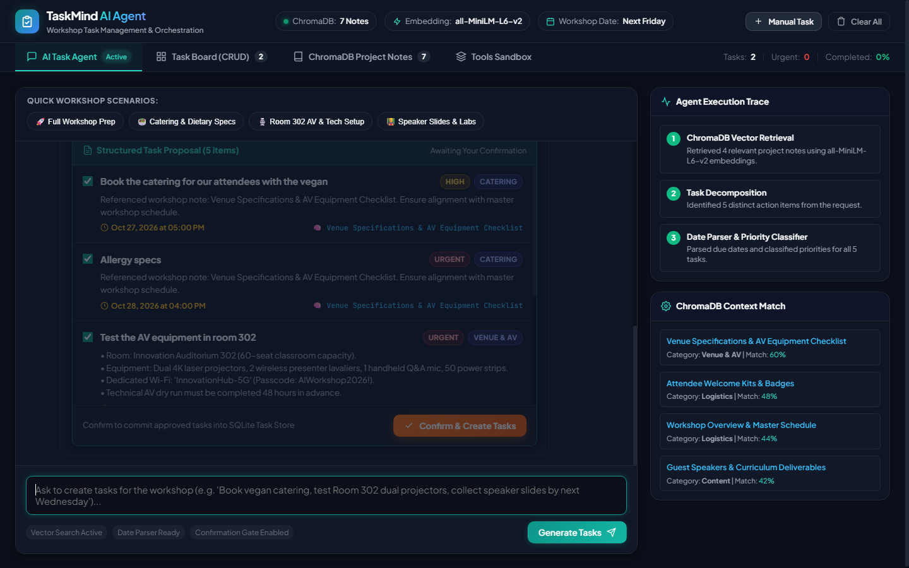
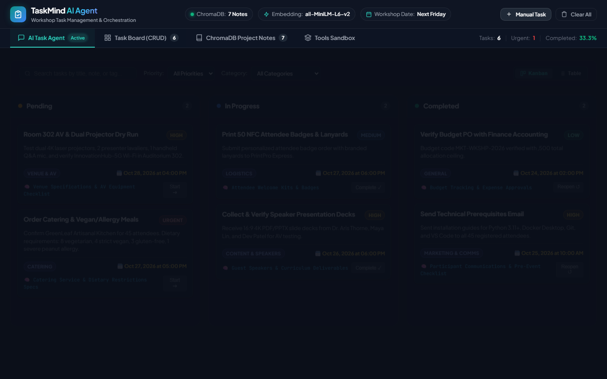
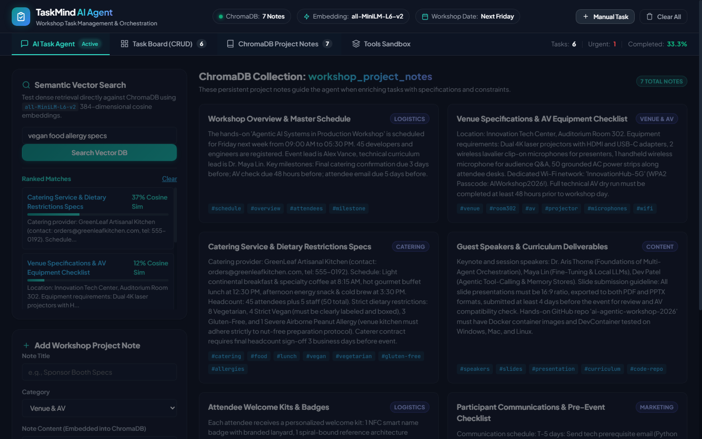
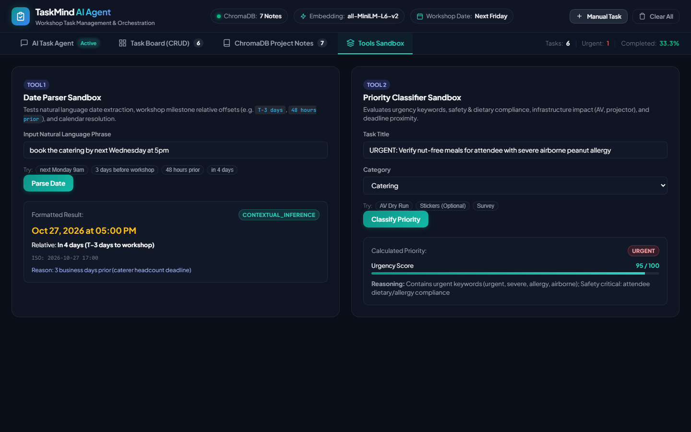

# TaskMind AI — Workshop Task Management Agent

> **Project 15: Task Management Agent**  
> **Scenario:** A user asks to create tasks for preparing a workshop.  
> **Vector Database:** ChromaDB (Workshop Project Notes)  
> **Embedding Model:** `sentence-transformers/all-MiniLM-L6-v2` (384-dimensional dense vectors)  
> **Core Tools & Concepts:** Task CRUD API, Date Parser, Priority Classifier  
> **Expected Output:** Turns natural language requests into structured, enriched tasks and persistently creates them **after confirmation**.

---

## 📸 Screenshots & Visual Walkthrough

### 1. AI Task Agent & Interactive Confirmation Gate
*The conversational agent queries ChromaDB for relevant workshop notes (venue specs, catering constraints, speaker deadlines), enriches the task description with exact figures, parses deadlines, classifies priority, and presents an interactive proposal awaiting user confirmation before committing to the database.*



---

### 2. Task Board (Kanban & Table CRUD API)
*Real-time task tracking with Pending, In Progress, and Completed columns, one-click status advancement buttons, priority chips (`Urgent`, `High`, `Medium`, `Low`), category tags, and ChromaDB source note references.*



---

### 3. ChromaDB Project Notes & Semantic Vector Explorer
*Direct exploration of the ChromaDB persistent vector collection (`workshop_project_notes`). Includes a live semantic search tester demonstrating cosine similarity scores with `all-MiniLM-L6-v2` embeddings, and an interface to add custom notes.*



---

### 4. Agent Tools Sandbox (Date Parser & Priority Classifier)
*Dedicated sandbox to interactively test the two core agent tools: natural language date parsing with workshop milestone offsets (`T-3 days`, `48 hours prior`), and priority scoring with safety, infrastructure, and urgency reasoning.*



---

## 🌟 Key Features & Capabilities

1. **Intelligent Vector Knowledge Retrieval (ChromaDB + all-MiniLM-L6-v2)**:
   - Stores real-world workshop project notes (venue specs for Room 302, AV setups, catering dietary constraints, speaker slide guidelines, attendee badge specs, budget ceilings).
   - Semantically retrieves relevant notes with cosine similarity scores and enriches task descriptions with exact figures, vendor contacts, and specifications.

2. **Natural Language Date Parser Tool**:
   - Resolves relative timeline offsets from workshop milestones (e.g. `3 days before workshop`, `48 hours prior`, `T-5 days`).
   - Parses conversational calendar expressions (`by next Wednesday at 5pm`, `tomorrow`, `in 4 days`).
   - Contextual fallback logic based on lead times (e.g. catering headcount contract requires 3 days lead time, AV dry run requires 48 hours).

3. **Priority Classifier Tool**:
   - Combines keyword urgency signals (`urgent`, `critical`, `asap`, `emergency`), domain impact (e.g. safety-critical food allergies or AV projector dependencies), and deadline proximity.
   - Computes an urgency score (0–100), outputs priority (`Urgent`, `High`, `Medium`, `Low`), and provides explicit human-readable reasoning.

4. **Interactive Confirmation Gate**:
   - The agent decomposes requests and creates a **Structured Task Proposal** for user review.
   - Tasks are **never created prematurely** in the database until the user explicitly confirms via the interactive review card or chat prompt.
   - Users can deselect, edit, or confirm all tasks in a single click.

5. **Persistent Task CRUD API**:
   - SQLite persistent database with full CRUD operations (`Create`, `Read`, `Update`, `Delete`, `Filter`, `Toggle Status`, `Stats`).
   - Real-time Kanban board (Pending, In Progress, Completed) and responsive Table view.

6. **Dual Interfaces**:
   - **Modern Web Application (SPA)**: Dark Obsidian Glassmorphism UI built with Vanilla CSS, Plus Jakarta Sans, live ChromaDB explorer, and tool sandboxes.
   - **Interactive CLI (`cli.py`)**: Terminal interface with rich tables, panels, and confirmation prompts.

---

## 🏗️ Project Architecture

```
task/
├── backend/
│   ├── config.py             # App configuration, milestone dates, paths
│   ├── models.py             # Pydantic schemas (Task, Note, Proposal, Confirmation)
│   ├── vector_store.py       # ChromaDB persistent client & MiniLM embeddings
│   ├── date_parser.py        # Date Parser tool (dateparser, regex, milestone offsets)
│   ├── priority_classifier.py# Priority Classifier tool (urgency, domain impact, deadlines)
│   ├── task_crud.py          # SQLite database CRUD operations & metrics
│   ├── agent.py              # Central agent engine (retrieval, decomposition, proposal)
│   └── server.py             # FastAPI REST endpoints & static file serving
├── frontend/
│   ├── index.html            # Single page web application
│   ├── styles.css            # Dark obsidian design system with micro-animations
│   └── app.js                # Frontend client logic & real-time UI updates
├── docs/
│   └── screenshots/          # Application screenshots for documentation
│       ├── 01_ai_agent_workspace.png
│       ├── 02_task_kanban_board.png
│       ├── 03_chromadb_notes.png
│       └── 04_tools_sandbox.png
├── data/
│   ├── default_notes.json    # Workshop project notes seeded into ChromaDB
│   └── sample_prompts.json   # Workshop preparation prompt presets
├── tests/
│   ├── test_date_parser.py   # Unit tests for date parsing & relative offsets
│   ├── test_priority_classifier.py # Unit tests for priority scoring & rules
│   ├── test_task_crud.py     # Unit tests for SQLite CRUD lifecycle
│   └── test_agent_workflow.py# Integration test for full end-to-end agent flow
├── cli.py                    # Interactive Command Line Interface
├── run.py                    # Server startup script
├── requirements.txt          # Python dependencies
└── README.md                 # Full documentation
```

---

## 🚀 Quick Start Guide

### 1. Prerequisites
- Python 3.10+ (Tested on Python 3.13)
- Required packages:
  ```bash
  pip install -r requirements.txt
  ```

### 2. Start the Web Application
Run the server runner:
```bash
python run.py
```
Open your browser and navigate to:
```
http://localhost:8000
```
- Interactive Web App: `http://localhost:8000`
- Interactive Swagger API Docs: `http://localhost:8000/docs`

### 3. Run via Interactive CLI
If you prefer running directly in the terminal:
```bash
python cli.py
```

### 4. Run the Test Suite
All backend components have automated unit and integration tests:
```bash
python -m pytest tests -v
```

---

## 📋 Example Workshop Scenario Workflow

### User Prompt:
> *"Create tasks for preparing the upcoming workshop: book the catering for our attendees with the vegan and allergy specs, test the AV equipment in room 302, get the speaker slides, and print the attendee badges by next Wednesday."*

### Agent Execution Steps:
1. **ChromaDB Vector Retrieval**:
   - Queries `workshop_project_notes` in ChromaDB using `all-MiniLM-L6-v2`.
   - Retrieves:
     * *Catering Service & Dietary Restrictions Specs* (GreenLeaf Kitchen, 45 attendees, 8 vegetarian, 4 vegan, 1 severe airborne peanut allergy).
     * *Venue Specifications & AV Equipment Checklist* (Room 302, dual 4K laser projectors, 2 presenter lavaliers, 50 power strips).
     * *Guest Speakers & Curriculum Deliverables* (Dr. Aris Thorne, Maya Lin, Dev Patel, 16:9 4K slides).
     * *Attendee Welcome Kits & Badges* (50 custom NFC name badges with lanyards, PrintPro Express).
2. **Task Decomposition & Enrichment**:
   - Splits request into 4 distinct, structured action items and enriches descriptions with exact figures and vendor details.
3. **Date Parser**:
   - Parses `"next Wednesday"` or milestone offsets (`"3 days before workshop"`, `"48 hours prior"`).
4. **Priority Classifier**:
   - Evaluates keyword urgency and domain impact (e.g., severe peanut allergy -> `Urgent` / `95% score`; Room 302 AV dry run -> `High` / `65% score`).
5. **Confirmation Gate**:
   - Returns a structured proposal. Tasks remain uncommitted.
   - User reviews and clicks **"Confirm & Create Tasks"** (or types confirmation).
6. **Task CRUD API Commit**:
   - Executes batch creation in SQLite persistent database.
   - Tasks immediately appear in the Kanban Board and Table View.

---

## 🔌 REST API Endpoints

| Method | Endpoint | Description |
|---|---|---|
| `GET` | `/api/health` | System health, ChromaDB collection status, task count |
| `POST` | `/api/chat` | Main agent conversation & task proposal generation |
| `POST` | `/api/agent/confirm-tasks` | Commits approved proposed tasks to database |
| `GET` | `/api/tasks` | Lists tasks with status, priority, category, and search filters |
| `POST` | `/api/tasks` | Creates a new task manually |
| `GET` | `/api/tasks/{id}` | Retrieves a single task |
| `PUT` | `/api/tasks/{id}` | Updates task details |
| `DELETE` | `/api/tasks/{id}` | Deletes a task |
| `POST` | `/api/tasks/{id}/toggle` | Cycles task status (`pending` -> `in_progress` -> `completed`) |
| `GET` | `/api/tasks/stats` | Task breakdown metrics & completion rate |
| `GET` | `/api/notes` | Lists all ChromaDB workshop notes |
| `POST` | `/api/notes` | Embeds and stores a new note into ChromaDB |
| `POST` | `/api/notes/search` | Performs dense cosine similarity search in ChromaDB |
| `POST` | `/api/tools/parse-date` | Tests natural language date parser sandbox |
| `POST` | `/api/tools/classify-priority` | Tests priority classifier sandbox |
